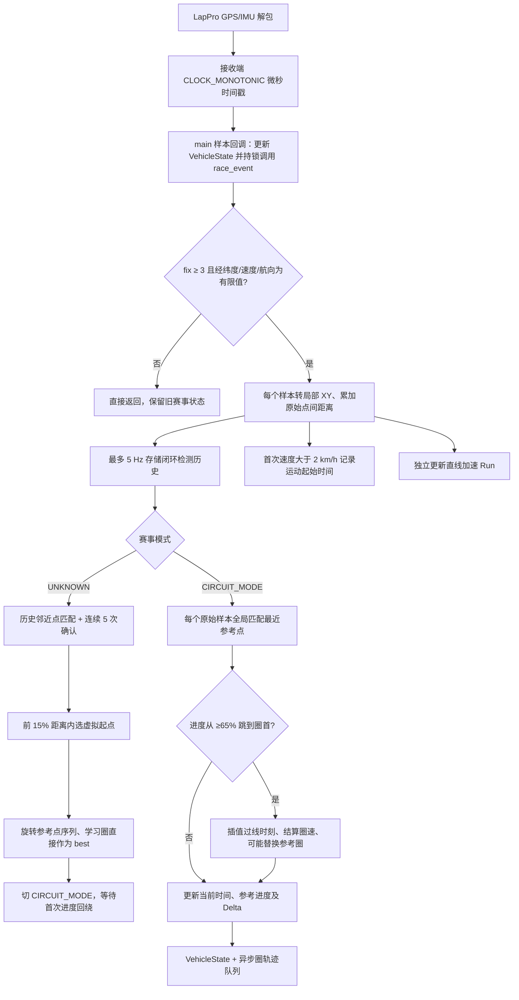

# GPS 赛道识别、圈速与 Delta：当前逻辑及代码审阅

> 历史审阅：下文针对修复前基线。起终线、首圈回溯及 Delta 已按两圈跑动需求修改，最新逻辑与验证见 [两圈跑动的圈速与实时 Delta](TRACK_LAP_DELTA_TIMING.md)。未纳入本轮范围的问题仍保留。

审阅日期：2026-09-06。代码基线：`015f06b4d689a6c67d84ddc15f3efe2dc25f7348`。本文描述当前工作区实际实现，不把历史说明或代码注释当作已经满足的需求。本次只新增审阅文档及索引，不修改算法。

## 1. 结论与需求满足度

当前代码具备“从 GPS 重复轨迹学习临时赛道 → 选择虚拟起点 → 计圈 → 相对最佳参考圈计算 Delta”的完整原型链路，固定容量存储、原始采样与参考采样分离、异步圈轨迹写盘的工程组织合理。

但尚不能作为可靠的赛车圈速实现验收。已复现：正常匀速闭环会生成偏短的参考圈，导致同速 Delta 不归零；跳过赛道的大部分路段仍能形成新的最佳圈；投影失效后计时字段冻结但 `lap_valid` 仍为真。根本问题是把“靠近历史点”和“参考进度回绕”分别当作精确闭环及有效完成一圈，缺少空间过线、连续进度和数据质量约束。

| 需求 | 当前实现 | 判断 |
| --- | --- | --- |
| 动态识别闭环赛道 | UNKNOWN 阶段识别一次重复轨迹，随后永久进入 CIRCUIT_MODE | 简单场景可用；没有持续确认、误识别恢复或更换赛道重学 |
| 自动寻找合适起点 | 闭环锚点之后前 15% 距离内选最直的 5 点窗口中点 | 有启发式实现；无优质候选时仍强行选点，没有保证起点合适 |
| 圈速计算 | 首次运动计时，之后由参考进度回绕分圈并插值时间 | 能输出成绩，但没有完整绕圈验证，不能保证成绩有效 |
| Delta 计算 | 当前圈经过时间减去最近参考点的时间 | 符号合理；离散化、参考圈偏差及错误匹配会造成错误 Delta |
| 最佳圈更新 | 更快圈的轨迹替换整个参考圈 | 正常路径已测试，但无效短圈可污染参考；学习圈直接被当成 best |
| GPS 异常处理 | 基础 fix/有限值检查；投影限制距离、航向 | 缺少中断恢复、跳点剔除、圈无效化和独立 Delta 有效性 |

以下将“已复现”与“静态分析”分开标注；没有进行本轮实车验证，也没有设定用户尚未指定的毫秒级精度指标。

## 2. 相关代码与职责

链接指向仓库文件；位置说明中的行号对应上述基线。

| 文件 | 关键入口 / 位置 | 职责 |
| --- | --- | --- |
| [lappro.c](../apps/terminal-core/src/lappro.c) | GPS 解包约 706–764 行；`lappro_update_state` | 解包 GPS/IMU，生成接收端单调时间戳，分发样本 |
| [main.c](../apps/terminal-core/main.c) | `main_lappro_sample_sink`，650–692 行 | 更新融合状态；持状态锁调用赛事算法 |
| [race_event.c](../apps/terminal-core/src/race_event.c) | `race_event_update`、`race_event_update_loop_detector` | 输入校验、运动起始时间、闭环识别、模式切换；并行调用直线加速算法 |
| [gps_track.c](../apps/terminal-core/src/gps_track.c) | `gps_track_sample`、`gps_track_find_virtual_start` | 经纬度转局部 XY、累计距离、降采样存储、选虚拟起点 |
| [lap_timer.c](../apps/terminal-core/src/lap_timer.c) | `configure_from_loop`、`find_projection`、`update`、`finish_current_lap` | 参考圈建立、位置匹配、过线判断、圈速、Delta、最佳圈及异步轨迹 |
| [gps_track.h](../apps/terminal-core/include/gps_track.h)、[lap_timer.h](../apps/terminal-core/include/lap_timer.h)、[race_event.h](../apps/terminal-core/include/race_event.h) | 状态结构及容量 | 算法全部长期状态 |
| [vehicle_state.h](../libs/vehicle-state/include/race/vehicle_state.h) | `VehicleState` | 圈号、圈时间、上一圈、最佳圈、Delta、参考进度、有效性字段 |
| [vehicle_state_clock.c](../apps/terminal-core/src/vehicle_state_clock.c) | `vehicle_state_clock_expire_lappro` | GPS 新鲜度失效时清 GPS 有效位，但不清 `lap_valid` |
| [hmi.c](../apps/terminal-core/src/hmi.c)、[logger.c](../apps/terminal-core/src/logger.c)、[webd_json.c](../apps/webd/src/webd_json.c) | 字段消费与导出 | HMI、融合 CSV、Web 输出算法状态 |

## 3. 当前完整逻辑链路



### 3.1 时间和 GPS 输入

1. LapPro 解包时同时保留设备 GPS 年月日、时分秒、毫秒，以及本机 `CLOCK_MONOTONIC` 微秒时间。
2. 算法实际使用回调参数 `timestamp_us`，即接收/解析时刻，未使用 GPS 测量时刻。Replay 复用样本回调及输入记录时间，不按回放加速倍率缩放圈速。
3. `race_event_update` 检查 fix 至少为 3，以及经纬度、速度、航向的 `isfinite`。未检查经纬度范围、hacc、样本时间严格递增、位置突跳或位置速度一致性。
4. 通过检查的每个样本都进入 GPS 局部坐标计算和直线加速模块。只有闭环检测历史限频，已经配置后的圈速更新仍使用每个原始样本。

### 3.2 轨迹坐标及缓存

首个有效位置为原点，使用局部等距近似：

```text
x = R × Δlongitude_rad × cos(origin_latitude_rad)
y = R × Δlatitude_rad
R = 6,371,000 m
```

`total_distance_m` 累加每对原始位置的欧氏距离；存储点的 `segment_distance_m` 为两次存储之间累计距离之差。因此检测阶段里程包含原始 GPS 噪声，并非降采样后折线长度。

- 历史存储最短间隔 200 ms，即最多 5 Hz。
- 实际 `GPS_TRACK_MAX_POINTS` 为 **4608**，不是根目录 `AGENT.md` 历史说明中的 4096。
- 满后用 `memmove` 丢弃较旧一半、保留 2304 点；检测器清连续匹配计数。
- `current_lap` 参考候选也按 200 ms 降采样，容量为 4610，开始/结束点允许强制写入。

### 3.3 首次运动与闭环检测

首次 `speed_kmh > 2.0` 记录 `movement_start_timestamp_us`。UNKNOWN 阶段 `lap_time_s` 显示从这个时刻起的时间，但 `lap_valid=false`、Delta 为 0；中途停车不重置它。

闭环检测仅在 UNKNOWN 且刚存入历史点时执行：

| 条件 | 当前值 |
| --- | --- |
| 历史点与当前点的时间差 | 15–900 s |
| 初次匹配位置距离 | ≤8 m |
| 初次匹配航向差 | ≤45° |
| 后续连续匹配位置距离 | ≤20 m |
| 后续连续匹配航向差 | ≤60° |
| 连续确认次数 | 至少 5 个存储点；恰好 5 Hz 时首末约 0.8 s |
| 连续匹配搜索范围 | 初始历史索引 + 当前索引增量，允许 ±2 点 |
| 历史锚点至确认时当前点累计距离 | ≥80 m |

初次按历史时间从早到晚查找，接受首个匹配，并将其解释为维修区汇入点；代码没有维修区几何模型。后续 `matched_index` 不推进匹配锚点，仍按初始索引差预测历史相位。

确认成功后返回的 `loop_end` 是**初次匹配点**，不是第 5 个确认点。时间/距离最终检查却使用第 5 个及之后的当前点，因此返回区间和验证区间不完全一致。参考周期取两个初始锚点的时间差，没有精确闭合插值。

### 3.4 虚拟起点选择

搜索闭环锚点前进方向前 15% 的累计距离，排除锚点本身。检查 5 个存储点的窗口：

- 相邻航向变化不超过 18°。
- 相邻存储段累计距离至少 0.5 m。
- 被检查点 hacc 有限且不超过 5 m。
- 整个窗口落在前 15% 内。
- 用“首末直线距离 / 窗口累计路程”评分，选择最高分窗口中间点。

没有合格窗口时，仍返回最接近 15% 距离处的 fallback 点。fallback 比较发生在越界判断之前，可能取到略超过 15% 的点。窗口循环也没有检查第一个点的 hacc；没有最小总直线长度、起终线横向净空、邻近支路距离或起点两侧质量验证。

### 3.5 初始化参考圈与首圈语义

`lap_timer_configure_from_loop` 将 `[loop_begin, loop_end)` 旋转为以虚拟起点为第 0 点的序列：

- 每点保留 XY、航向、速度；相对时间按学习周期取回绕差值。
- 参考进度 `distance_s_m` 重新累加相邻参考点间直线距离，并加最后一点到起点的闭合距离得到圈长。
- `reference_lap_time_s` 为闭环锚点时间差；直接赋给 `best_lap_time_s`。
- 设置 `lap_number=1`、`waiting_for_initial_crossing=true`。
- 当前圈起始时间仍是首次运动时间；用识别完成时的实时点初始化投影，不回放检测延迟期间已经发生的过线。
- `current_lap` 却从 `loop_end` 的时间开始，在虚拟起点坐标处放一个合成点。这与 `lap_start_timestamp_us` 不同。
- 配置后立即输出 `lap_valid=true`，即使仍在等待首次过线。

如果确认时已经越过选定起点，必须再绕一圈才结束 lap 1。因此 lap 1 是“运动开始到识别之后首次被观察到的过线”，可能包含维修区、暖胎或超过一圈；它不是保证同一起终线的完整圈。等待期间 Delta 固定为 0，后续等待更新把 `track_distance_m` 设为 0。

### 3.6 投影、过线、圈速

所谓 projection 是**全局最近参考顶点**，没有投影到线段：先排除航向差超过 60° 的点，再取距离最小者；最近距离大于 30 m 则直接返回。没有使用上一进度约束候选。

过线判据：

```text
上一参考点进度 ≥ 0.65 × L
当前参考点进度 ≤ 0.25 × L  （首次等待阶段）
当前参考点进度 ≤ 0.10 × L  （正式计圈阶段）
```

没有真实起终线方程、线段相交或带方向侧别测试。过线时间插值为：

```text
a = L - s_previous
b = s_current
t_cross = t_previous + (t_current - t_previous) × a / (a + b)
```

这里的 s 是离散参考顶点进度，不是两次 GPS 位置到几何线的有符号距离。退化情况返回当前样本时间。

首次回绕结算 lap 1 后进入 lap 2；正式圈还要求过线间隔至少 3 s，然后记录 `last_lap_time_s`、递增圈号、重置起始时间。无累计绕圈进度、最小有效行程、分段通过顺序或缺测上限。

### 3.7 最佳圈、Delta 与输出

结算时在候选轨迹末尾合成原起点坐标。只有圈速严格小于 best，且候选未溢出、至少 2 点、时间和圈长为有限正值，才整体替换参考圈，同时更新 best。不会检查这条候选是否真的覆盖了原赛道。

每个成功匹配样本：

```text
current_time_s = (sample_timestamp_us - lap_start_timestamp_us) / 1e6
delta_time_s   = current_time_s - matched_reference.time_s
track_distance_m = matched_reference.distance_s_m
```

Delta 正值表示比参考慢，负值表示比参考快。`track_distance_m` 是参考圈位置，并非本圈实际累计行驶距离。它可以因全局匹配跳变而倒退。最佳圈刷新后的 Delta 改用新参考。

`VehicleState` 输出当前/上一圈/最佳圈/Delta 等字段，没有单独的 `delta_valid`、参考来源、圈无效原因或参考版本。当前这条链路没有计算“预计圈速”的独立字段；[USAGE.md](USAGE.md) 中关于预计圈速的描述超出本次找到的实现。

圈轨迹经容量 256 的队列交给独立 writer，队列满则丢记录并计数。当前内存参考更新不依赖写盘成功。等待首次过线时只创建 lap 1 文件，没有入队其样本；现有测试明确预期该文件只有表头。正常跨线样本归入下一圈，内存合成的精确边界点也没有相应写入 CSV，不能把 CSV 直接视作完整边界轨迹。

## 4. 主要审阅发现

优先级定义：P1 为会破坏有效成绩、Delta 或核心需求的正确性问题；P2 为可靠性、使用语义或覆盖范围问题。不是对实车发生概率的定量评级。

### P1-1：近邻闭环被当作精确闭合，参考周期偏短【已复现】

位置：`race_event.c:46–80, 176–191`；`lap_timer.c:594–619, 643–644`。

返回历史位置附近 8 m 内就允许建立闭环锚点，不需要越过同一空间截面。车在真正回到历史点之前就会触发；连续确认只证明后续相似，未修正锚点。多候选时优先最早历史点，也不能保证两个锚点具有相同赛道相位。

复现：用与现有测试相同的局部经纬度转换，半径 100 m、周期 90 s、50 Hz、hacc=1 m、fix=3 的无噪声圆形轨迹。按坐标切线给航向，输入速度字段 25 km/h。

```text
输入运动时间    best        last        delta       lap
90 s           89.000000   0.000000    0.000000    1
180 s          89.000000   95.100000   1.100000    2
270 s          89.000000   90.000000   1.100000    3
```

相同轨迹、相同周期的正式圈为 90 s，却无法超过错误的 89 s best；Delta 持续偏正。问题同时污染参考周期及旋转后时间分布，不只是显示舍入。

建议：近邻匹配仅作为发现候选的条件；固定一条几何起终线后，回溯两次同方向过线，用过线插值得到相同相位的边界和参考时间。学习参考与正式 best 分开，先完成有效线到线圈再发布 best。

### P1-2：缺少完整绕圈校验，短路/跳点可以刷新最佳圈【已复现】

位置：`lap_timer.c:298–353, 457–530, 790–818`。

每点全局匹配，计圈只要求 65%→10% 回绕和 3 s 间隔；候选重建只检查点数、数值和容量。途径中间分段不是必要条件。

在上述圆形输入运行至 280 s 后，直接向公开 `lap_timer_update` 输入参考序列约 75% 处的点（时间 +4 s）、一个远离赛道的点（+1 s）、起点（+1 s）。点的航向取对应参考航向。结果：

```text
lap_before=4  lap_after=5  last=10.900000  best=10.900000
```

这是模拟 GPS 跳点或缺失大量路段的确定性异常输入，未模拟真实车辆瞬移；算法目前没有拒绝它。一次错误短圈还会替换赛道参考，放大后续错误。

建议：区分位置可匹配、进度连续、本圈有效、已完成一圈；加入速度/时间可达性、累计有向进度、顺序检查点和缺测限制。无效圈不得刷新 best/reference。过线使用有方向、有限宽度的几何线段。

### P1-3：GPS/投影失效不清状态，恢复后跨空白插值【部分已复现】

位置：`race_event.c:234–241`；`lap_timer.c:701–703, 726–734`；`vehicle_state_clock.c:47–62`。

无 fix 直接返回；投影不在 30 m/60° 条件内也直接返回，既不清 `previous_projection_valid`，也不使本圈/Delta 失效。外层 GPS 新鲜度检查只清 GPS 位，不清 `lap_valid`。

上述异常输入中，远离赛道的样本之后观察到 `lap_valid=1` 且 `lap_time_s` 完全冻结。随后回起点仍可与中断前参考点拼成过线。静态分析同样表明：长时间无 fix、BLE 断流或离轨后恢复会跨整个空白时段做插值，无法证明空白期间何时/几次过线。

建议：GPS 数据质量和匹配有效性显式传播到 lap/Delta；中断后清跨样本过线状态，暂停 Delta，按缺测策略使当前圈无效并重新建立连续位置。运行时间显示可继续计时，但不能伪装成有效成绩。

### P1-4：最近顶点匹配不满足连续位置 Delta【静态分析】

位置：`lap_timer.c:298–328, 824–829`。

参考点最多 5 Hz，当前更新可达 50 Hz。即便沿完全相同轨迹匀速行驶，最近顶点的参考时间仍呈台阶，同一点被匹配期间 Delta 随时间增加，切换点时突然跳变。理想均匀采样下单纯量化约为半个参考采样间隔，即约 ±0.1 s；这不是包含定位误差和分支歧义后的总误差上限。

平行直道、发夹弯邻近同向支路、交叉处也可能匹配到远处进度。没有连续进度搜索范围，30 m 的固定容差对紧凑赛道尤其宽松。

建议：在预测进度附近对参考折线做线段投影，得到连续 s；对 `t_ref(s)` 插值，再计算 Delta。结合航向、横向距离、前向进度和时间可达性处理分支；无法唯一匹配时使 Delta 无效。

### P1-5：无法撤销误识别或学习新赛道【静态分析】

位置：`race_event.c:269–312`。

闭环只检测一次；进入 CIRCUIT_MODE 后永远只调用旧 `lap_timer_update`，没有退出、重新确认或重学路径。候选仅验证约 0.8 s 的局部重复轨迹，不验证完整路线拓扑；“最早历史近邻就是维修区汇入点”的假设也没有输入依据。

如果“动态识别”仅指上电后首次自动学习，则具备基础能力；如果包括运行中换赛道、误识别纠正、进出维修区，则尚未实现。建议增加候选/确认/计时/丢失/重学状态，并设置赛道一致性与重新学习触发条件。

### P2-1：起点选择没有可用性保证【静态分析】

位置：`gps_track.c:141–163, 195–259`。

前 15% 限制是当前产品假设，不是从 GPS 推导出的维修区边界。该范围可能全部是弯道；无合格窗口时仍强制成功。5 点通常只覆盖 0.8 s，18° 相邻航向阈值并不保证整窗总转向足够小，也未要求起点远离近邻支路。

建议：按物理长度和总曲率评估连续直道，检查全部窗口点及邻近赛道净空；无合格区域时保持学习状态或扩大搜索，显式报告质量不足。若必须严格前 15%，fallback 不应突破条件。

### P2-2：首圈、学习圈和正式有效圈混用【静态分析及上述首圈结果】

位置：`lap_timer.c:533–543, 640–682, 755–782`。

lap 1 是从首次运动到首次观察到起点回绕，学习圈却已发布为 best；等待期间 `lap_valid=true`、Delta=0 容易被理解为“有效且正好持平”。参考候选从 `loop_end` 开始，首圈成绩从运动开始计算，两者时间原点不同。若特殊输入导致首圈进入更快分支，候选轨迹和传入圈速就不具有同一计时语义。

建议：明确区分 out-lap/学习参考/有效计时圈，首个合格过线只武装计时，下一次完整有效过线才产生成绩；若产品要展示起步累计时间，应单独标识。

### P2-3：4608 点并不保证任意启动相位下覆盖 900 s 圈【已复现】

位置：`gps_track.c:98–108`；`gps_track.h:8–10`。

虽然空缓存从第一个样本开始能存 900 s，但一次丢掉一半后只保留约 460.8 s 历史，长圈闭合所需锚点会消失。启动前静止也持续占历史空间。

复现：先在圆形起点静止采样 60 s，再以 5 Hz 输入周期 900 s 的圆形轨迹 920 s。结果 `mode=UNKNOWN`，剩余历史 2597 点，未在第一次完整绕圈后确认。现有“900 s 存储预算”测试只从空缓存连续填充 900 s，未触发压缩。

建议：用逐点覆盖的时间窗口环形缓存，保证任意时刻都保留最大周期加确认余量；静止记录、候选锚点保护及长圈应一并设计。

### P2-4：计时使用接收时间，输入质量与时间序约束不足【静态分析】

位置：`lappro.c:739–764`；`race_event.c:234–249`；`gps_track.c:93–101`；`lap_timer.c:824–828`。

BLE 聚包、重传、线程调度会改变接收间隔，目前这些抖动直接进入圈速和 Delta。代码保留 GPS 时间却未用于测量时间轴；缺少实测延迟分布，不能从代码推断真实误差数值。

算法也没有严格拒绝重复/倒序时间；`gps_track_sample` 甚至将倒序时间当作必须存储，正式圈的无符号时间减法在时间早于起始时间时会下溢。实时单调时钟正常工作时通常不会发生倒序，但 Replay 或直接 API 输入仍需明确契约。hacc 只在起点部分窗口过滤，低质量定位仍能进入闭环、里程和参考更新。

建议：建立经校验的测量时间轴并保留接收时间用于新鲜度/延迟诊断；处理重连、乱序、重复和时钟映射。统一做 hacc、范围、位置增量及速度一致性过滤。

### P2-5：轨迹和状态接口不足以审计成绩【静态分析】

位置：`lap_timer.c:202–226, 670–671, 736–752, 785–786, 818–835`；`vehicle_state.h:55–57`。

lap 1 CSV 只有表头；其他圈 CSV 没有完整插值边界，队列满可丢记录。字段未携带圈有效原因、过线事件或参考版本，最佳参考切换时仅靠 `distance_s_m/time_s` 难以重建全过程。原始 LapPro 日志可以辅助重放，但不等价于明确的成绩事件记录。

建议：单独持久化过线时刻、圈结果、有效原因、参考版本及学习参数；日志丢失状态也应可查询，参考轨迹按版本保留。

### 附带健壮性问题

`race_event_update` 将 `state==NULL` 放入入口拒绝条件，却在同一分支只判断 `event!=NULL` 就写 `state->event_mode`（234–240 行），存在空指针解引用。主回调始终传入有效 state，本次未作为主链路故障复现；建议修复入口保护并添加边界测试。

## 5. 本次验证与现有测试缺口

### 已执行

```bash
cmake --preset host-debug
cmake --build --preset host-debug --target \
  test_race_event_laptime test_lap_timer_best_reference \
  test_lap_timer_trace test_race_event_accel --parallel 4
ctest --preset host-debug -R \
  '^(race_event_laptime|lap_timer_best_reference|lap_timer_trace_async|race_event_parallel_accel)$'
```

配置、相关目标编译成功，4/4 测试通过。本次没有修改生产代码；未执行全项目测试、ARM 构建或实车验证。

另编写主机临时探针，复用 `tests/test_race_event_laptime.c` 的 `update_local` 输入转换，链接实际 `race_event.c`、`gps_track.c`、`lap_timer.c`、`accel_test.c`，调用公开入口。源文件及可执行文件放在忽略的 `out/review-track/`，不作为仓库交付依赖。上节记录的数值来自该探针实跑。

重建探针的输入规格：圆轨迹 `x=100*cos(2π*t/P)`、`y=100*sin(2π*t/P)`；航向为 `(360−360*t/P) mod 360`；原点 30°N、120°E；复用现有测试的 `111111` 经纬度换算。第一组 `P=90 s`、步长 0.02 s、起始 timestamp=1,000,000 μs，运行至 280 s 后输入 P1-2 的三点。第二组先从 timestamp=1,000,000 μs 开始静止 300 个 0.2 s 样本，再从 timestamp=61,000,000 μs 开始输入 `P=900 s`、步长 0.2 s 的圆轨迹 920 s。

### 现有覆盖为何未发现问题

| 测试 | 已覆盖 | 主要缺口 |
| --- | --- | --- |
| [test_race_event_laptime.c](../tests/test_race_event_laptime.c) | 运动起时、模式切换、圈号增长、50 Hz 下识别 90 s 圆、空缓存 900 s 容量 | 圆形输入只断言识别成功，未断言参考周期、实际圈速及同速 Delta；没有缓存压缩后长圈测试 |
| [test_lap_timer_best_reference.c](../tests/test_lap_timer_best_reference.c) | 更快圈替换时间分布、后续 Delta 使用新参考、参考降采样 | 输入主要恰好落在参考顶点；未验证线段中间 Delta、非法短圈、分支及连续性 |
| [test_lap_timer_trace.c](../tests/test_lap_timer_trace.c) | 异步建文件、不覆盖旧文件、表头/样本存在、无丢写 | 未校验完整过线边界；还明确接受第一圈只有表头 |
| [test_race_event_accel.c](../tests/test_race_event_accel.c) | 直线加速与赛道模式并行 | 不承担圈速准确性验证 |

后续验收应至少增加：相同轨迹同速 Delta 归零；不同速度分布的解析 Delta；采样相位/频率变化；起终线附近抖动和停车；反向与近邻支路；缺测跨起点、恢复与长断流；短路圈不更新 best；低 hacc 质量及突跳；识别后已越起点；缓存压缩和最长圈；换赛道重新学习。先确定产品精度和缺测容忍要求，再为这些场景设数值阈值。

## 6. 建议整改顺序

1. **阻止错误成绩传播**：增加圈/Delta 有效性、中断处理、连续进度与完整绕圈校验，无效圈不能替换参考；学习参考与正式 best 分离。
2. **统一起终线和时间基准**：选有限宽度、带方向的几何起终线，回溯相同相位过线，消除近邻锚点造成的参考周期偏差；明确测量时间与接收时间。
3. **连续 Delta**：局部线段投影与 `t_ref(s)` 插值，处理交叉、平行支路及匹配歧义。
4. **补齐动态学习生命周期**：质量不足不强行选起点，支持候选验证、丢失恢复、误识别撤销和重学；使用真正连续覆盖最大周期的历史缓存。
5. **建立成绩可审计性与回归集**：固定上述复现为自动测试，记录过线事件/参考版本/失效原因，并用真实 GPS 轨迹验证指标。
