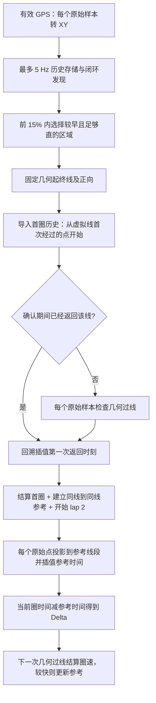

# 两圈跑动场景：首圈成绩、起终线与实时 Delta

更新日期：2026-09-06。本次修复以 FSE 常见的两圈跑动为目标：首圈有成绩，首圈结束就能用已有轨迹提供 Delta，不额外要求学习圈或武装圈。

原始问题及修复前证据见 [代码审阅](TRACK_LAP_DELTA_REVIEW.md)。本文为修复后的实际逻辑；原审阅保留为历史记录。

## 1. 可见行为

- 从首次速度大于 2 km/h 开始显示运行时间。
- 自动发现闭环并选定虚拟起终线。第一次返回该线，便结算 `last_lap_time_s`，进入 lap 2，开始实时 Delta。
- 若闭环检测的连续确认完成时已经过线，回溯保存的 GPS 点，恢复那次过线时间，立即输出首圈成绩及当前第二圈 Delta。不会再等下一圈。
- 首圈成绩保留“起步到首次返回虚拟线”的时间，因此可包含进入赛道的路段；不把它强行当作可比较的标准圈。
- 同时，从第一圈历史中截取“第一次经过虚拟线到返回同一条线”的轨迹，直接作为 Delta 参考。这是利用同一圈已采集的数据，不要求多跑一圈。
- `best_lap_time_s` 使用这个同线到同线参考的周期；第二圈更快时用第二圈替换参考。首圈显示成绩与初始 best 可能不同，原因是二者起始时刻不同。

“第一圈结束”指第一次返回选定虚拟线，并非知道官方起终线。线的位置自动选在闭环锚点之后前 15% 内；实际首次出成绩时间还受该位置、GPS 输入间隔及闭环确认时机影响。算法不能在尚未返回该线时精确结算同线圈速。

## 2. 修复后的链路



### 起点选择

保留前 15% 与 5 点直线窗口的策略。候选直线度得分差不超过 0.002 时保留更早的窗口，避免微小数值差异把起点推到更后面。补齐窗口首点 hacc 检查，并让 fallback 搜索先检查 15% 距离边界。

这仍是自动选点的启发式策略；本次未增加官方赛道配置或维修区几何模型。

### 起终线与过线时间

线中心为选中的历史点，正向为该点前后相邻历史点连线的单位方向。起终线与正向垂直，半宽 20 m，选定后保持不变，最佳圈更新不移动它。

```text
side(P) = dot(P - line_center, direction)
过线条件：side(previous) < 0 且 side(current) >= 0
alpha = -side(previous) / (side(current) - side(previous))
t_cross = t_previous + alpha × (t_current - t_previous)
```

还检查交点在有限线宽内、时间正序和至少 3 s 的计圈间隔。使用实际 GPS 线段插值交点位置、时间、速度和航向；不再用“参考进度 65%→10%”推测过线，也不再把进入历史点 8 m 邻域的时刻直接当作圈边界。

8 m 闭环条件只负责发现候选，不再决定参考周期。这样消除了原先 90 s 匀速轨迹被学成 89 s 的偏差来源。

### 首圈历史复用

`lap_timer_configure_from_loop` 从虚拟起点开始按时间顺序导入历史轨迹，不再旋转一个近似闭合周期。闭环初次匹配及后续确认点通过同一个 `lap_timer_update` 回放，因此已经发生的首次返回可以立即结算。

如果确认时还没到线，则继续向同一条首圈参考候选追加实时点；过线后参考完整，不需要再次绕圈。首圈显示计时仍从首次运动开始，参考计时从历史虚拟起点开始，这两个时间原点分别保存。

### 连续 Delta

对每条非退化参考线段 A→B 求最近投影：

```text
u = clamp(dot(P-A, B-A) / |B-A|², 0, 1)
s_ref = s_A + u × (s_B - s_A)
t_ref = t_A + u × (t_B - t_A)
delta = (t_now - t_lap_start) - t_ref
```

航向按最短角差插值，保留 60° 航向与 30 m 投影距离条件。起终线附近按当前点所在线的一侧筛选参考圈前/后半段，避免不同走线使圈尾比圈首更近，造成整圈量级的 Delta 跳变。

圈参考保存实际过线交点。不同圈可在同一条线的不同横向位置经过，不补一条具有虚构时间的横向闭合段。更快圈重建参考后，同样用连续插值计算 Delta。

## 3. 实时性与接口

- 原始 GPS 到达一次，圈速和 Delta 更新一次。参考/检测仍最多 5 Hz 存储，不把实时更新降到 5 Hz。
- 起终线检查为常数工作量；线段投影为 O(N)，N 最大受固定参考容量限制。比较平方距离，仅对更近候选计算航向，避免每个候选都做开方。
- 首圈识别只导入已有内存历史；不在状态锁内做文件 I/O，也不把整个历史圈一次塞进 256 条写盘队列。
- 圈轨迹仍通过独立 writer 写出。导入的首圈历史不补写整个 lap 1 CSV，首圈文件可能只有表头或确认后的尾段；首圈完整参考在内存中可用，原始 GPS 日志仍可用于重放。
- `VehicleState` ABI 和既有 HMI/Web 字段保持兼容，`lap_valid` 仍是已有计时状态标志，不等同于正式比赛的成绩认证。
- 没有参考时 best/Delta 为 0；首圈返回后建立参考并实时输出。GPS 匹配失败时 Delta 仍可能保留旧值，本次未建立失效/短路圈状态机。

当前时间轴仍是既有接收端 `CLOCK_MONOTONIC`；BLE 延迟、GPS 噪声、低采样率和走线差异依然影响实车精度。下列数值只验证算法在合成输入上的正确性，不表示实车达到了毫秒级绝对精度。

## 4. 验证

新增 [test_lap_timer_accuracy.c](../tests/test_lap_timer_accuracy.c)，通过实际 `race_event_update` 驱动圆形 GPS 输入，并逐个样本检查第二圈 Delta。

| 场景 | 验证结果 |
| --- | --- |
| 90.000 s 周期，50 Hz 输入 | 90.600 s 首次给出成绩并开始 Delta；最佳参考为 90 s，非 89 s |
| 90.037 s 周期，50 Hz 输入 | 90.640 s 首次给出成绩；过线不与 5 Hz 历史网格对齐仍正确 |
| 30.073 s 周期，约 14.3 Hz 输入 | 30.730 s 首次给出成绩；第二圈最大绝对 Delta 约 0.000003 s |
| 第二圈 84 s，叠加正弦局部时间分布 | 4424 个样本对比解析 Delta，最大误差约 0.000001 s |
| 已经过线再完成检测 | 既有方形赛道测试改为断言识别时立即进入 lap 2、已有首圈结果 |
| 不同横向走线及跨样本过线 | 插值到预期 20.000000 s；较快参考更新后圈首 Delta 不匹配到圈尾 |
| 更快第二圈 | 无额外武装圈，3.5 s 圈立即替换 4 s 参考，后续 Delta 使用新时间分布 |

合成同速用例对每个第二圈样本要求 `|Delta| < 3 ms`、完整圈时间误差 `< 2 ms`；不同速度分布要求与解析值误差 `< 4 ms`。这些是回归断言而非实车精度承诺。

执行方式：

```bash
cmake --preset host-debug
cmake --build --preset host-debug --parallel 4
ctest --preset host-debug

cmake --preset host-sanitize
cmake --build --preset host-sanitize --target \
  test_lap_timer_accuracy test_race_event_laptime test_lap_timer_best_reference \
  test_lap_timer_trace test_race_event_accel --parallel 4
ctest --preset host-sanitize -R \
  '^(race_event_laptime|lap_timer_accuracy|lap_timer_best_reference|lap_timer_trace_async|race_event_parallel_accel)$'

cmake --preset arm-release
cmake --build --preset arm-release --target race_core test_lap_timer_accuracy --parallel 4
```

本轮主机全套 23/23、相关 ASan/UBSan 测试 5/5 通过；ARM `race_core` 和精度测试目标交叉编译通过。没有部署或运行板端测试，没有实车计时器对照测量。
